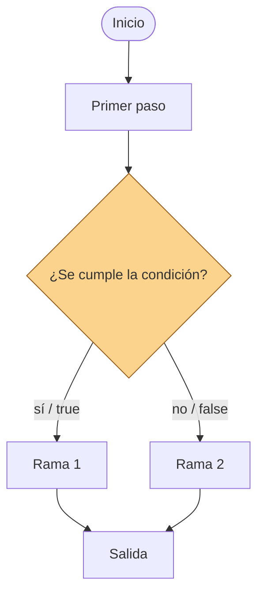

# Clase 7 — Decisiones con IF

**Duración:** 120 minutos  
**Nivel:** inicial, retoma los primeros pasos de n8n  
**Modalidad:** repaso breve, explicación con diagrama, construcción manual y práctica en equipos  
**Producto:** el workflow de inscripciones de la clase 6 completo, con un nodo IF que clasifica la modalidad y prepara un mensaje distinto en cada rama

## Idea central

En la clase 6 el flujo fue una línea recta: cada nodo recibía datos, hacía una tarea y entregaba el resultado al siguiente. A veces, sin embargo, un proceso necesita **decidir**: si se cumple una condición, hacer una cosa; si no se cumple, hacer otra.

> Un nodo IF es un **bifurcador**: recibe datos y los envía por una de dos salidas según una condición.

En esta clase el caso sigue siendo la inscripción a un taller, pero ahora la confirmación debe adaptarse según la modalidad:

```text
Inicio manual
  → Cargar inscripción
  → Completar registro
  → Preparar confirmación
  → ¿Modalidad presencial?
     ├─ sí → Confirmación presencial
     └─ no → Confirmación remota
```


## Objetivos de aprendizaje

Al finalizar la clase, cada estudiante podrá:

- explicar qué problema resuelve una ramificación dentro de un flujo;
- reconocer el nodo IF y sus dos salidas (true / false);
- escribir una condición sencilla con un campo del item actual;
- observar cómo se comporta el IF con distintos valores de `modalidad`;
- preparar mensajes distintos según la rama que se ejecute;
- leer el INPUT y el OUTPUT de cada rama;
- reconocer validaciones como otra forma de decidir;
- mencionar cuándo conviene IF y cuándo Switch.


## Preparación

Esta clase presupone que n8n está instalado y funcionando con Docker (preparado en la clase 6). Antes del encuentro:

1. Comprobá que Docker Desktop está iniciado.
2. Iniciá n8n desde la carpeta `n8n/` de la clase 6:

```console
docker compose up -d
```

3. Abrí `http://127.0.0.1:5678` y verificá que la cuenta y los workflows de la clase 6 siguen disponibles.

Si el entorno no quedó funcionando en la clase anterior, seguí los pasos de la sección **Preparación del entorno n8n** de la [clase 6](../clase_06/clase_6_primeros_pasos_con_n8n.md) antes de comenzar.


---

## 1. Retomar el workflow (10 min)

1. Abrí n8n en `http://127.0.0.1:5678`.
2. Abrí el workflow **Clase 6 - Registro de inscripciones**.
3. Ejecutalo y verificá que los nodos que construiste siguen funcionando.

Si del encuentro pasado quedaron **Inicio manual**, **Cargar inscripción** y **Completar registro**, completá ahora el nodo **Preparar confirmación** siguiendo los pasos de la clase 6 antes de continuar:

| Campo final | Tipo | Expresión |
|---|---|---|
| `inscripcion_id` | String | `{{ $json.inscripcion_id }}` |
| `estado` | String | `{{ $json.estado }}` |
| `taller` | String | `{{ $json.taller }}` |
| `modalidad` | String | `{{ $json.modalidad }}` |
| `cantidad_asistentes` | Number | `{{ $json.cantidad_asistentes }}` |
| `confirmada` | Boolean | `{{ $json.confirmada }}` |
| `mensaje` | String | `{{ $json.mensaje }}` |

Al terminar, el flujo se ve así:

```text
Inicio manual
  → Cargar inscripción
  → Completar registro
  → Preparar confirmación
```

Guardá el workflow antes de seguir.

---

## 2. ¿Qué es una decisión? (10 min)

Pensá en la atención de un incidente de soporte:

> Un usuario avisa que una impresora de tickets no imprime. Si el problema es de papel, se recarga el papel; si el problema es de conexión, se revisa la red; si es otra cosa, se escala.

En los tres casos los datos de entrada son parecidos, pero la **acción** cambia según la condición. Eso es una decisión.

En un flujo, una decisión se dibuja como un rombo que pregunta y reparte: envía los datos por un camino u otro.



En n8n, ese rombo es el nodo **IF**. El IF no modifica los datos: **decide por dónde continuar**. Cada salida se llama **rama**.

Respondé en voz alta:

- ¿En qué paso de la inscripción podría hacer falta decidir?
- ¿Qué condición conviene comprobar primero?

---

## 3. El nodo IF (10 min)

El nodo **IF** (de **I**f, "si") recibe un item y evalúa una condición. Tiene dos salidas:

- **true**: se usa cuando la condición se cumple.
- **false**: se usa cuando la condición no se cumple.

```text
         ┌────────────┐  true  ┌──────────────────────────┐
INPUT ──▶│  nodo IF   │───────▶│  Confirmación presencial │
         │            │  false ┌────────────────────────┐
         └────────────┘───────▶│  Confirmación remota   │
                               └────────────────────────┘
```

La condición se escribe con tres partes:

```text
campo del item     operador     valor de comparación
{{ $json.modalidad }}   equals   presencial
```

- **Valor izquierdo:** qué se evalúa (normalmente un campo del item con una expresión).
- **Operador:** cómo se compara (`equals`, `not equal`, `contains`, `exists`…).
- **Valor derecho:** con qué se compara (un valor fijo u otra expresión).

> En esta clase usamos `equals` entre strings. `presencial` y `"presencial"` son el mismo valor; `Presencial` con mayúscula sería distinto: la comparación distingue mayúsculas y minúsculas.

El nodo IF **no crea** campos nuevos. Los items que viajan por cada rama conservan los datos que ya tenían.

---

## 4. Construcción guiada (25 min)

Vas a agregar la decisión después de **Preparar confirmación**.

### Paso 1 — Agregar el nodo IF

1. Agregá un nodo **IF**.
2. Conectalo desde **Preparar confirmación**.
3. Renombralo **¿Modalidad presencial?**.

### Paso 2 — Configurar la condición

1. Abrí el nodo **¿Modalidad presencial?**.
2. En **Value 1**, activá el modo **Expression** y escribí:

```text
{{ $json.modalidad }}
```

3. En **Operation**, seleccioná **String → equals** (o **Is equal to**).
4. En **Value 2**, escribí el valor fijo:

```text
presencial
```

Queda así:

```text
{{ $json.modalidad }}  equals  "presencial"
```

Guardá el nodo y el workflow.

### Paso 3 — Rama true: Confirmación presencial

1. Agregá un nodo **Edit Fields**.
2. Conectalo desde la salida **true** de **¿Modalidad presencial?**.
   - En el canvas, la conexión true aparece con la etiqueta **true** al arrastrar desde el borde del IF.
3. Renombralo **Confirmación presencial**.
4. Dejá activado **Include Other Input Fields** para conservar todos los datos.
5. Agregá el campo `mensaje_final`, tipo String, en modo **Expression**:

```text
=Hola {{ $json.nombre }}, tu lugar en la modalidad presencial está confirmado.
```

### Paso 4 — Rama false: Confirmación remota

1. Agregá otro nodo **Edit Fields**.
2. Conectalo desde la salida **false** de **¿Modalidad presencial?**.
3. Renombralo **Confirmación remota**.
4. Dejá activado **Include Other Input Fields**.
5. Agregá el campo `mensaje_final`, tipo String, en modo **Expression**:

```text
=Hola {{ $json.nombre }}, tu lugar en la modalidad remota está confirmado. Te enviaremos el enlace por correo.
```

### Paso 5 — Ejecutar y observar

Antes de ejecutar, respondé:

- Si `modalidad` vale `presencial`, ¿qué rama se ejecuta?
- ¿Y si vale `remota`?
- ¿Qué pasa si vale `"presencial"` con mayúscula?

Ejecutá el workflow completo y abrí los nodos en orden:

1. Inicio manual.
2. Cargar inscripción.
3. Completar registro.
4. Preparar confirmación.
5. ¿Modalidad presencial?
6. Confirmación presencial **o** Confirmación remota (la que corresponda).

Revisá en el IF:

- ¿Cuántos items entraron?
- ¿Cuál salida quedó activa?
- ¿Los datos de la rama conservan todos los campos de entrada?

Salida esperada para `modalidad = presencial`:

```json
{
  "inscripcion_id": "INS-001",
  "estado": "registrada",
  "taller": "Introducción a n8n",
  "modalidad": "presencial",
  "cantidad_asistentes": 1,
  "confirmada": true,
  "mensaje": "Hola Lucía Gómez, tu inscripción fue registrada.",
  "mensaje_final": "Hola Lucía Gómez, tu lugar en la modalidad presencial está confirmado."
}
```

Si aparece **Presencial**, **presencial**, **PRESENCIAL** u otro texto, el IF toma la rama false (o falla) porque la comparación distingue mayúsculas. Esto es un caso de error típico: hay que controlar qué valores puede tomar el campo antes de decidir.

---

## 5. Ejercicio en equipos: diseñar un flujo de su trabajo (30 min)

Trabajen en dos grupos. Cada grupo diseña, en papel o con un diagrama (ASCII o Mermaid), un flujo de un proceso real de su trabajo diario que podría automatizarse.

Consigna:

1. Elegí un proceso de tu trabajo que hoy se resuelve a mano (una falla, un aviso, un registro).
2. Definí con detalle la **entrada de datos**: qué campos recibe el flujo y de qué tipo son (texto, número, sí/no).
3. Marcá el **punto de decisión**: la condición exacta que separa el flujo en dos caminos.
4. Definí las **dos salidas**: qué acción se hace en cada rama y qué datos entrega cada una.
5. Pensá la **excepción**: qué pasa si el dato no entra en ninguna rama esperada.

**Entregable del grupo:** el flujo completo con su entrada (campos y tipos), su decisión (condición y ramas true/false), su salida (datos y destinatario) y su excepción (a dónde se deriva).

- **Grupo 1:** atención de tickets o incidentes (clasificar y derivar).
- **Grupo 2:** mantenimiento o verificación de equipos (decidir si corresponde intervenir).

---

## 6. Puesta en común (15 min)

Cada grupo presenta su flujo al resto (5 min por grupo): qué entra, qué se decide, qué sale y a dónde va la excepción.

El otro grupo hace una observación de acierto y una de mejora. El docente cierra con la síntesis común: qué patrones se repiten en ambos flujos.

---

## 7. Cierre (5 min)

Completá oralmente:

1. Un nodo IF envía cada item por la salida ______ o ______.
2. La condición se compone de valor izquierdo, ______ y valor derecho.
3. Definir la entrada y la salida de un flujo sirve para ______.
4. La excepción de una decisión es ______.

Idea final:

> No se automatiza una decisión sin antes saber qué datos entran, qué valores puede tomar cada campo y qué debe pasar en cada rama, incluida la excepción.

## Conexión con la próxima clase

En el próximo encuentro vas a combinar varias decisiones: más de una condición a la vez, respuestas cuando nada se cumple y la idea de repetir pasos. Lo que diseñaste hoy —entrada, decisión, salida y excepción— es la base para flujos con más de una bifurcación.

## Referencias

- [Nodo IF](https://docs.n8n.io/integrations/builtin/core-nodes/n8n-nodes-base.if)
- [Nodo Edit Fields](https://docs.n8n.io/integrations/builtin/core-nodes/n8n-nodes-base.set)
- [Estructura de datos](https://docs.n8n.io/build/work-with-data/understand-n8ns-data-structure)
- [Crear y ejecutar workflows](https://docs.n8n.io/build/understand-workflows/create-and-run-workflows)
