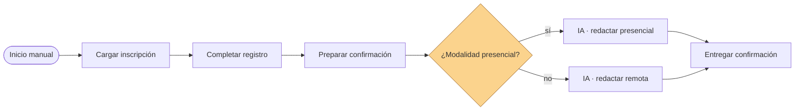

# Clase 8 — Incorporación de IA en Workflows

**Duración:** 120 minutos  
**Nivel:** inicial, retoma los flujos de las clases 6 y 7 (nodos, IF, ramas)  
**Modalidad:** repaso breve, explicación con diagramas, construcción guiada y práctica en equipos  
**Producto:** el workflow de inscripciones ampliado con un nodo de IA que clasifica automáticamente el mensaje de confirmación y lo redacta según la modalidad

## Idea central

En las clases 1 a 3 se aprendió a usar IA generativa escribiendo **prompts** desde un chat. En las clases 6 y 7 se aprendió a construir **automatizaciones** con n8n. **Esta clase une ambos mundos**: la IA deja de ser una herramienta aparte y se convierte en un **nodo dentro del flujo**.

Eso significa que un workflow puede:

- **clasificar** automáticamente una solicitud (¿esto es una falla de red, una consulta o un pedido de mantenimiento?);
- **resumir** un texto largo (un ticket, un correo, un parte);
- **extraer** datos de un texto (números de ticket, equipos, fechas);
- **redactar** respuestas (confirmaciones, derivaciones, mensajes a usuarios).

Todo con un **prompt** que nosotros escribimos, aplicado a los datos que ya circulan por el flujo.

```text
Inicio manual
  → Cargar inscripción
  → Completar registro
  → Preparar confirmación
  → ¿Modalidad presencial?
     ├─ sí → IA: redactar confirmación presencial
     └─ no → IA: redactar confirmación remota
```



> Un **prompt dinámico** es un prompt que no está escrito fijo: incluye datos del flujo (por ejemplo, `{{ $json.nombre }}`). Así la misma instrucción sirve para cada inscripción distinta.

## Objetivos de aprendizaje

Al finalizar la clase, cada estudiante podrá:

- explicar qué es un **LLM** como nodo dentro de n8n y cómo se configura;
- conectar n8n a un proveedor de modelos (**OpenRouter**) mediante credenciales;  
- distinguir las tareas típicas de un LLM en un flujo: clasificar, resumir, extraer y redactar;
- escribir un **prompt dinámico** que use datos del item actual (`{{ $json... }}`);
- ajustar el prompt para obtener **salidas estructuradas** (texto, etiqueta, JSON);
- reconocer cuándo conviene que una decisión la tome la IA y cuándo un IF (clase 7);
- identificar límites y buenas prácticas: no enviar datos sensibles, verificar salidas y no delegar decisiones importantes sin revisión.

## Preparación

Esta clase presupone que n8n está instalado y funcionando con Docker (clase 6) y que tenés una **cuenta en OpenRouter** con saldo o modelo gratuito disponible.

1. Comprobá que Docker Desktop está iniciado.
2. Iniciá n8n desde la carpeta `n8n/` de la clase 6:

```console
docker compose up -d
```

3. Abrí `http://127.0.0.1:5678` y verificá que los workflows de las clases 6 y 7 siguen disponibles.
4. Creá (o usá) una **API key de OpenRouter**:

| Paso | Acción |
|---|---|
| 1 | Entrá a [openrouter.ai](https://openrouter.ai/keys) e iniciá sesión |
| 2 | Seleccioná **Create new secret key** |
| 3 | Copiá la clave (empieza con `sk-or-...`) y guardala en un lugar seguro |

> Si el entorno no quedó funcionando en la clase anterior, seguí la sección **Preparación del entorno n8n** de la [clase 6](../clase_06/clase_6_primeros_pasos_con_n8n.md).

## Materiales

Dentro de la carpeta `n8n/` de esta clase:

- [`Clase 8 - Contrato y prompts de IA.json`](n8n/Clase%208%20-%20Contrato%20y%20prompts%20de%20IA.json): archivo documental de referencia (contratos, prompts de ejemplo y casos de prueba).
- [`Clase 8 - Inscripciones con IA.json`](n8n/Clase%208%20-%20Inscripciones%20con%20IA.json): respaldo importable del workflow terminado.

> Los JSON son **respaldo de referencia**: en clase el workflow se construye manualmente desde el canvas (como en las clases anteriores). La API key **no** va incluida en el JSON: cada participante crea la suya en OpenRouter.

---

## 1. Retomar el workflow y agregar la credencial (15 min)

1. Abrí n8n en `http://127.0.0.1:5678`.
2. Abrí el workflow **Clase 7 - Registro de inscripciones con IF**.
3. Ejecutalo y verificá que los nodos de la clase 7 siguen funcionando (Inicio manual → Cargar inscripción → Completar registro → Preparar confirmación → ¿Modalidad presencial? → Confirmación presencial/remota).

### Agregar la credencial de OpenRouter

1. En el menú lateral de n8n, entrá a **Credentials**.
2. Creá una credencial del tipo **OpenRouter API**.
3. Pegá tu API key en el campo **API Key**.
4. Guardala con un nombre claro (ej. **OpenRouter clase**).

> La credencial queda guardada en n8n, encriptada. No se comparte ni se sube a ningún repositorio. Nunca pegues tu API key en un chat de IA ni en un archivo del curso.

Guardá una copia del workflow con otro nombre (**Clase 8 - Inscripciones con IA**) antes de modificar el original.

---

## 2. ¿Cómo entra la IA a un flujo? (10 min)

En n8n un modelo de lenguaje se agrega como un **nodo de modelo**, y el texto que produce se genera con la estructura que armamos alrededor: un prompt, un sistema o un "chat".

Lo más simple para esta clase es el nodo **AI Agent**: recibe un item, le pasa un prompt al modelo y devuelve el texto generado. Debajo del agente se conecta el **OpenRouter Chat Model** (el modelo de lenguaje).

```text
                           ┌──────────────────────────────┐
  INPUT (item) ──▶ AI Agent │  system: sos un asistente... │
  (nombre, taller,          │  prompt: redactá la        │
   modalidad)                │  confirmación para {{nombre}} │
                            └──────────────┬───────────────┘
                                           ▼
                             OUTPUT (texto del modelo)

  AI Agent ── Chat Model ──▶ OpenRouter Chat Model (modelo)
```

Respondé en voz alta:

- ¿En qué paso del workflow de inscripciones podría servir que la IA redacte un texto?
- ¿Qué datos del item necesita el prompt para redactar bien?

> **Diferencia con el chat de la clase 2:** acá el prompt se escribió una vez y se ejecutó para cada inscripción distinta, sin copiar y pegar nada a mano.

---

## 3. Construcción guiada: IA que redacta la confirmación (35 min)

Vamos a reemplazar los textos fijos de **Confirmación presencial** y **Confirmación remota** por un nodo **AI Agent** (con su **OpenRouter Chat Model** conectado) que los redacta con IA.

### Paso 1 — Agregar el AI Agent

1. Agregá un nodo **AI Agent**.
2. Conectalo desde la salida **true** de **¿Modalidad presencial?**.
3. Renombralo **IA · redactar presencial**.
4. En el nodo, en **Prompt** (origen del mensaje), seleccioná **Define below** y escribí el prompt dinámico:

```text
Datos de la inscripción:
- Nombre: {{ $json.nombre }}
- Taller: {{ $json.taller }}
- Modalidad: {{ $json.modalidad }}

Redactá el mensaje de confirmación para la modalidad presencial.
```

5. En **Options → System Message**, escribí el rol del sistema:

```text
Sos el sistema de confirmaciones de inscripciones de un casino. Redactá
en una sola línea un mensaje en español, cordial y claro, que confirme
el lugar en la modalidad presencial. Respondé únicamente con el texto
del mensaje, sin comillas, sin saludos previos ni explicaciones.
```

> El agente usa `{{ $json.nombre }}` **dentro del prompt**: por eso se llama prompt dinámico. Si el item cambia, el mensaje cambia.

### Paso 2 — Conectar el modelo de lenguaje

1. Agregá un nodo **OpenRouter Chat Model** (sub-nodo de lenguaje).
2. Ubicalo debajo del agente y conectá su salida **Language Model** al puerto **Chat Model** de **IA · redactar presencial**.
3. En el nodo, seleccioná la credencial de OpenRouter que creaste y un modelo habilitado (ej. `openai/gpt-4o-mini`).
4. Configurá una temperatura baja (aprox. `0.2`) para resultados más consistentes.

### Paso 3 — Configurar la rama remota

Repetí los pasos 1 y 2 en la salida **false** de **¿Modalidad presencial?** con el agente **IA · redactar remota** (prompt que indique que el enlace se enviará por correo) y su propio **OpenRouter Chat Model**.

### Paso 4 — Ejecutar y observar

1. Ejecutá el workflow y abrí **IA · redactar presencial**.
2. Observá el **OUTPUT**: el texto generado. Comparalo con el texto fijo de la clase 7 (ya no hay `mensaje_final` fijo: ahora lo redacta la IA).

Respondé:

- ¿El texto cambia si cambio el nombre o la modalidad?
- ¿Qué pasa si el modelo devuelve más de una línea? (lo veremos al estructurar la salida)

### Paso 3 — Hacer la salida estructurada

Un LLM devuelve texto libre; para que el resto del flujo lo use bien conviene **pedirle un formato claro**.

Agregá al prompt:

```text
Respondé únicamente con el texto del mensaje, sin comillas, sin
saludos previos ni explicaciones.
```

> Pedir el formato en el prompt es una **restricción** (vista en la clase 2). No garantiza un 100%; por eso conviene revisar la salida antes de usarla en una comunicación real.

---

## 4. IA que clasifica (20 min)

Además de redactar, la IA puede **clasificar**. En lugar de que un IF compare un valor fijo (clase 7), la IA decide a partir de texto libre. 

Ejemplo útil para el área: un ticket llega como texto y queremos saber si es una **falla**, una **consulta** o un **pedido**. Eso no siempre se puede resolver con un IF (los textos son variables), pero la IA lo hace razonablemente.

### Construcción

1. Agregá un **AI Agent** llamado **IA · clasificar**.
2. Conectalo antes de la rama de confirmación (por ejemplo, desde **Preparar confirmación**).
3. Conectá su **OpenRouter Chat Model** (el mismo sub-nodo de modelo que usaste para redactar, o uno nuevo).
4. En el prompt:

```text
Clasificá la siguiente solicitud de soporte en una de estas tres
categorías: FALLA, CONSULTA, PEDIDO.

Respondé únicamente con una de las tres palabras, en mayúsculas.

Solicitud: {{ $json.mensaje }}
```

5. Agregá un nodo **IF** después de **IA · clasificar** para separar según la categoría:

```text
{{ $json.output }}   equals   FALLA
```

> Nota: el nombre del campo que devuelve el AI Agent puede variar según la versión. Al ejecutar, mirá el OUTPUT y usá ese nombre en el IF.

Respondé:

- ¿El texto del ticket de ejemplo (clase 5) se clasificó bien?
- ¿Y si el texto fuera ambiguo? La IA hace lo mejor posible, pero un humano debe revisar los casos importantes.

---

## 5. Resumen y extracción (opcional, 10 min)

Con el mismo nodo **AI Agent** se pueden cubrir las otras dos tareas típicas:

**Resumir** (un parte de incidencias):

```text
Resumí en hasta tres viñetas el siguiente parte, sin inventar datos:
{{ $json.parte }}
```

**Extraer** (datos de un texto hacia campos):

```text
Del siguiente texto extraé: número de ticket, equipo afectado y
prioridad. Respondé en JSON con los campos ticket, equipo y prioridad.
Texto: {{ $json.detalle }}
```

Respondé:

- ¿En qué tarea de tu trabajo harías un resumen automático?
- ¿Y una extracción de datos (por ejemplo, de un correo a un ticket)?

> La extracción con IA es la puerta de entrada a las integraciones de la clase 9: si la IA convierte un texto libre en JSON, otro sistema lo puede consumir.

---

## 6. Ejercicio en equipos: agregar IA a su flujo (15 min)

Trabajen en dos grupos. Cada grupo toma **el flujo que diseñó en la clase 7** (entrada, decisión, salida, excepción) y decide en qué paso **agregar IA**:

1. Elegí la tarea de IA que aporta valor: clasificar, resumir, extraer o redactar.
2. Escribí el **prompt dinámico** con las restricciones de salida (formato, tono, idioma).
3. Indicá qué datos del item alimentan el prompt (`{{ $json... }}`).
4. Marcá en el diagrama dónde se revisa la salida de la IA (¿la usa un humano o sigue sola en el flujo?).
5. Definí la **excepción**: qué pasa si la IA no devuelve lo esperado.

**Entregable del grupo:** el diagrama del flujo con el nodo de IA marcado, el prompt escrito y la decisión de "usar directo vs. revisar antes".

- **Grupo 1:** atención de tickets o incidentes (clasificar con IA y redactar la respuesta).
- **Grupo 2:** mantenimiento o verificación de equipos (resumir el parte e identificar el equipo a intervenir).

---

## 7. Puesta en común (10 min)

Cada grupo presenta su flujo (5 min): qué tarea de IA eligió, con qué prompt y dónde se revisa la salida.

El otro grupo hace una observación de acierto y una de mejora. El docente cierra con la síntesis común: **la IA no reemplaza la estructura del flujo** (entrada, decisión, excepción) — la convierte en un nodo más, y siempre hay que decidir cuánto se confía en su salida.

---

## 8. Cierre (5 min)

Completá oralmente:

1. Un LLM dentro de n8n se configura con una credencial de ______ y un nodo ______.
2. Un prompt dinámico usa datos del item con la expresión ______.
3. Las cuatro tareas típicas de IA en un flujo son: clasificar, ______, ______ y ______.
4. Para que un IF use la salida de la IA, el prompt debe pedir una salida ______.
5. Cuando la IA decide algo importante, conviene ______ antes de aplicar la acción.

Idea final:

> La IA es un nodo más del flujo: recibe datos, los procesa con un prompt y devuelve un texto. La calidad está en el prompt (clases 1-3) y en el diseño del flujo (clases 4-7): por eso esta clase llega recién ahora.

## Conexión con la próxima clase

En la clase 9 vas a conectar el flujo con sistemas internos del área (archivos, carpetas compartidas, bases de datos, APIs internas). La extracción de datos con IA que viste hoy (texto → JSON) es exactamente el puente: el flujo podrá tomar lo que un sistema escribe y convertirlo en lo que otro sistema necesita.

## Referencias

- [Nodo AI Agent](https://docs.n8n.io/integrations/builtin/cluster-nodes/root-nodes/n8n-nodes-langchain.agent/)
- [Nodo Chat OpenRouter (OpenRouter Chat Model)](https://docs.n8n.io/integrations/builtin/cluster-nodes/sub-nodes/n8n-nodes-langchain.lmchatopenrouter/)
- [Credenciales OpenRouter en n8n](https://docs.n8n.io/integrations/builtin/credentials/openrouter/)
- [Generar API key en OpenRouter](https://openrouter.ai/keys)
- [Prompt engineering en n8n](https://docs.n8n.io/advanced-ai/intro-tutorial/)
