# Clase 9 — Un sistema consulta a otro por una API

**Duración:** 120 minutos. **Modalidad:** cada persona trabaja de forma individual siguiendo esta guía en su propio n8n. El TV se usa solo para las demostraciones que se hacen en conjunto. Si algo no se distingue desde todos los lugares, ampliá el nodo en pantalla.

Antes de cada ejecución, **predecí**: escribí en una nota qué creés que va a pasar y después compará con el resultado. No hay predicción incorrecta: lo que importa es comprobar.

> Para entender las ideas antes de la práctica, leé la [introducción conceptual sobre integración y API](introduccion_conceptual_integracion_y_api.md).

## Primero: una imagen que nos acompaña toda la clase

Toda la clase funciona como una **ventanilla de informes**. Cuando necesitás un dato que guarda otro sector, no entrás a su archivo: presentás un formulario, un empleado busca en el archivo y te entrega **solo la constancia que está permitido mostrar**.

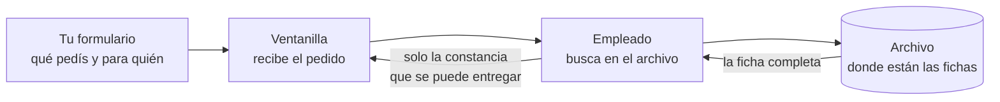

Cada parte de la ventanilla va a tener un nombre técnico en la clase:

| En la ventanilla | En la clase se llama | Ejemplo |
|---|---|---|
| El formulario | **Método** + **dirección** + **parámetro** | `GET /inventario/equipos?codigo=CAM-02` |
| La ventanilla abierta | **Webhook** | el nodo Webhook de n8n |
| El archivo | **Tabla** de datos | `equipos_clase9` |
| El empleado que busca | el workflow **Inventario** | los nodos de n8n |
| La constancia | **Respuesta JSON** | los campos que devuelve la API |

No hace falta memorizar esta tabla: la vamos a ir llenando con la práctica.

### Palabras que vamos a usar

| Palabra | En lenguaje común |
|---|---|
| API | La ventanilla de un sistema: el lugar por donde otros pueden pedirle información. |
| GET | Un pedido de "consultar sin cambiar nada". |
| Parámetro | El dato que completás en el pedido para precisar qué buscás: `codigo=CAM-02`. |
| JSON | La forma de escribir la respuesta con campos de nombre y valor. Ya lo trabajamos en la [clase 5](../clase_05/clase_5_como_hablan_los_sistemas.md). |
| Publicar / activar | Dejar la ventanilla atendida: el workflow queda disponible para recibir pedidos. |

## Situación inicial

Recibís un aviso: una cámara del pasillo aparece sin señal. Para preparar la visita necesitás saber dónde está y qué estado figura en el inventario. Ese dato no lo tiene el seguimiento: lo administra otro sistema, el **inventario**.

¿Cómo puede el seguimiento consultar ese dato **sin entrar al archivo del inventario**? Vamos a representar los dos sistemas con **dos workflows de n8n**:

- **Inventario**: tiene la tabla (el archivo) y abre una ventanilla (la API).
- **Seguimiento**: hace el pedido por la ventanilla y lee la respuesta.

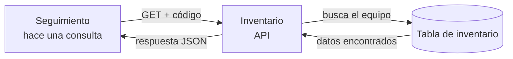

## Tu consigna: qué tenés que lograr

Al terminar esta guía, tus dos workflows tienen que funcionar así:

1. Inventario guarda **esta tabla** de equipos ficticios:

| codigo | ubicacion | estado | nota_interna |
|---|---|---|---|
| `CAM-01` | `Recepción` | `operativa` | `Control mensual OK` |
| `CAM-02` | `Pasillo` | `sin señal` | `Verificar alimentación y conexión` |
| `CAM-03` | `Salón de juegos` | `operativa` | `Lente con polvo` |

2. Desde el navegador o desde Seguimiento hacés **este pedido**:

```text
GET /webhook/inventario/equipos?codigo=CAM-02
```

3. Y recibís **esta respuesta** (fijate que `nota_interna` no aparece, aunque está en la tabla):

```json
{
  "codigo": "CAM-02",
  "ubicacion": "Pasillo",
  "estado": "sin señal"
}
```

Todo lo que necesitás para lograrlo está en los pasos 1 a 9. Si algo no sale, la sección 5 tiene la tabla de diagnóstico.

### Objetivo y resultados esperados

Construir una consulta sencilla entre dos sistemas simulados. Al terminar vas a poder: reconocer en un pedido el método, la dirección, el parámetro y la respuesta; explicar **dónde se decide qué información se comparte**; y comprobar el resultado de una consulta.

**Recorrido:** situación, ventanilla y vocabulario (15 min); tabla de inventario (20 min); abrir la API (30 min); consultar desde el navegador y desde Seguimiento (30 min); puesta en común, IA y cierre (15 min).

**Preparación:** haber trabajado con JSON en la [clase 5](../clase_05/clase_5_como_hablan_los_sistemas.md) y con n8n en la [clase 6](../clase_06/clase_6_primeros_pasos_con_n8n.md). Usamos el [mismo n8n en Docker](../clase_06/n8n/README.md), sin agregar otro contenedor. Iniciá Docker Desktop y n8n como en la clase 6, y abrí `http://127.0.0.1:5678`.

## 1. ¿Qué vamos a construir?

Nuestro pedido va a ser una sola línea que ya conocés del punto anterior:

```text
GET /inventario/equipos?codigo=CAM-02
```

Leído en lenguaje común: *"consultá (sin cambiar nada) en la ventanilla de equipos del inventario, el equipo cuyo código es CAM-02"*. La respuesta va a ser un JSON con los campos que Inventario decida mostrar.

En esta práctica, Inventario permite consultar por código y devuelve **código, ubicación y estado**. También guarda una nota interna, pero no la incluye en la respuesta. El flujo de Seguimiento elige el código; **no decide qué campos de la tabla serán públicos**: eso lo decide Inventario.

Dos aclaraciones para no confundirse:

- Las **tablas de n8n** guardan datos entre ejecuciones; funcionan como el archivo de la ventanilla.
- Inventario y Seguimiento son dos workflows en la **misma instalación** de n8n: **simulan** dos sistemas distintos; no son dos aplicaciones independientes.

## 2. Sistema Inventario: crear y cargar la tabla

En n8n creá un workflow llamado **Inventario - crear tabla y API**. El primer tramo prepara el inventario: primero se arma el archivo (la tabla) y después se cargan las fichas.

Cada paso muestra un diagrama con **cómo tiene que ir quedando tu canvas**. Compará el dibujo con lo que ves en pantalla antes de seguir al paso siguiente.

### Paso 1. Crear la tabla

La tabla es el **archivo de la ventanilla**: donde el inventario guarda una ficha por equipo.

1. Agregá **Manual Trigger** y conectá un nodo **Data Table**.
2. En Data Table elegí **Resource → Table**, **Operation → Create** y **Name → equipos_clase9**.
3. En **Columns**, agregá estas cuatro columnas, todas de tipo **String**:

| Nombre de columna | Qué guarda |
|---|---|
| `codigo` | Identificador del equipo |
| `ubicacion` | Lugar donde está instalado |
| `estado` | Estado registrado |
| `nota_interna` | Observación del inventario |

4. **Predicción:** ¿cuántas filas va a tener la tabla recién creada? Anotá la respuesta antes de ejecutar.
5. Ejecutá el workflow con **Execute workflow** y comprobá que el nodo terminó correctamente. La tabla queda guardada en n8n. Este tramo se ejecuta **una sola vez**: no lo vuelvas a ejecutar para probar la API, porque intentaría crear otra tabla con el mismo nombre.
6. En el proyecto, abrí **Data tables** y buscá `equipos_clase9` para ver la tabla creada. Volvé al workflow.

**Así tiene que quedar tu canvas al terminar el paso 1:**

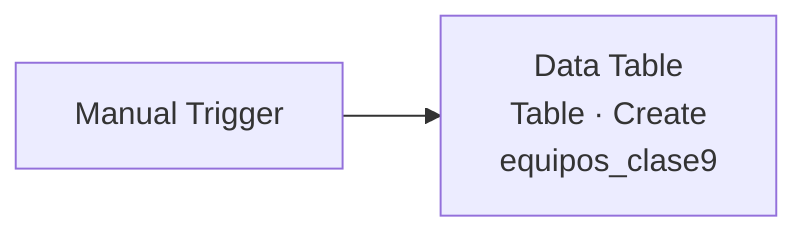

✅ **Checkpoint:** la tabla `equipos_clase9` aparece en **Data tables** con sus cuatro columnas y **0 filas**.

### Paso 2. Cargar las tres fichas del inventario

Ahora metemos **tres fichas** en el archivo, tal como están en la consigna del principio. Vamos a usar **tres nodos de inserción en cadena**, uno por equipo: así cada nodo lleva valores escritos a mano y no hace falta leer datos de otro lado.

1. Desconectá el nodo que creó la tabla: arrastrá la línea desde su punto de salida hacia un espacio vacío del canvas, hasta que se suelte. **No lo borres**: lo dejamos ahí como recordatorio de cómo se creó la tabla. Así, al ejecutar, solo corre el nodo de carga.
2. Agregá un nodo **Data Table** conectado a **Manual Trigger**. Elegí **Resource → Row**, **Operation → Insert** y en **Data table** seleccioná `equipos_clase9`.
3. En **Mapping Column Mode**, elegí **Map Each Column Manually** y completá la primera ficha:

| Columna | Valor |
|---|---|
| `codigo` | `CAM-01` |
| `ubicacion` | `Recepción` |
| `estado` | `operativa` |
| `nota_interna` | `Control mensual OK` |

4. Agregá un **segundo nodo Data Table** con la misma configuración (Row · Insert · `equipos_clase9`) y conectalo **después del primero**. Completá:

| Columna | Valor |
|---|---|
| `codigo` | `CAM-02` |
| `ubicacion` | `Pasillo` |
| `estado` | `sin señal` |
| `nota_interna` | `Verificar alimentación y conexión` |

5. Agregá un **tercer nodo Data Table** igual, conectado después del segundo:

| Columna | Valor |
|---|---|
| `codigo` | `CAM-03` |
| `ubicacion` | `Salón de juegos` |
| `estado` | `operativa` |
| `nota_interna` | `Lente con polvo` |

6. **Predicción:** al ejecutar, ¿cuántas filas va a tener la tabla? ¿Qué creés que va a pasar si ejecutás dos veces?
7. Ejecutá el workflow con **Execute workflow**. Los tres nodos corren en cadena y cargan las tres fichas. Abrí **Data tables → equipos_clase9** y comprobá que haya **3 filas**. No vuelvas a ejecutar este tramo: insertaría las fichas repetidas.

**Así tiene que quedar tu canvas al terminar el paso 2:**

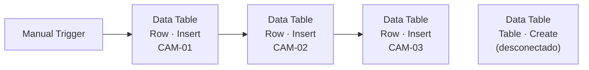

El nodo `Table · Create` queda suelto en el canvas, sin línea hacia ningún lado (en el dibujo está a la derecha solo por orden de lectura). Es intencional: se ejecutó una sola vez y ya no forma parte del flujo.

El archivo [datos_inventario.json](datos_inventario.json) reúne los tres registros ficticios y el pedido de prueba para revisarlos sin abrir n8n. No contiene datos reales.

✅ **Checkpoint:** la tabla tiene exactamente **3 filas** y la de `CAM-02` dice `sin señal`.

**Observá:** ¿cuáles son las columnas de la tabla? ¿Qué diferencia hay entre el `estado` registrado y la `nota_interna`? Uno es el dato que otros sistemas pueden necesitar; el otro es una observación interna del sector que tiene el archivo.

## 3. Sistema Inventario: abrir la ventanilla (la API)

En el **mismo workflow**, agregá otro tramo, separado del tramo de preparación. Este tramo no se ejecuta con un clic: se activa **cuando llega un pedido**. Son cuatro nodos en fila, como la atención en la ventanilla:

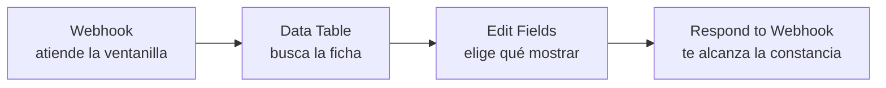

### Paso 3. Recibir una consulta

Agregá un nodo **Webhook** y configurá:

- **HTTP Method:** `GET`.
- **Path:** `inventario/equipos`.
- **Authentication:** `None`, únicamente para esta práctica local.
- **Respond:** `Using 'Respond to Webhook' node`.

El Webhook abre la ventanilla y le pone un cartel: *"pedidos por acá"*. Su dirección tiene dos versiones, y este es el punto donde más se confunde:

| Versión | Cuándo funciona | Para qué sirve |
|---|---|---|
| **Test URL** | Solo después de apretar **Listen for test event** y mientras n8n escucha | Probar el workflow desde la pantalla de n8n. |
| **Production URL** | Cuando el workflow está **publicado / activado** | La dirección real, siempre atendida. |

En esta práctica usamos la **Production URL del n8n local**, porque el segundo workflow tiene que consultar sin que nadie esté apretando "Listen".

**Tu canvas al terminar el paso 3** (el tramo de preparación ya está hecho y la ventanilla se agrega suelta, todavía sin conexiones):

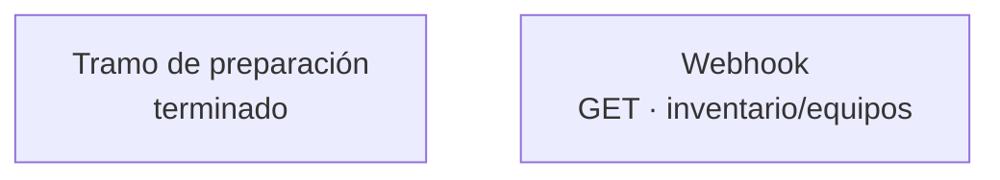

### Paso 4. Buscar la ficha en la tabla

Conectá al Webhook un nodo **Data Table**:

1. Elegí **Resource → Row**, **Operation → Get** y la tabla `equipos_clase9`.
2. En **Conditions**, agregá una condición: **Column → codigo**, **Condition → Equals**.
3. En **Value**, seleccioná **Expression** y escribí:

```text
{{ $json.query.codigo }}
```

**Cómo leer esa expresión.** `{{ ... }}` es el modo en que n8n inserta un valor que viene de afuera. `query` es el bolsillo donde el Webhook guarda los parámetros del pedido, y `codigo` es el nombre del parámetro que completamos. O sea: *"el código que llegó en el pedido"*. La condición busca la fila cuyo `codigo` sea igual a ese valor.

**Tu canvas al terminar el paso 4:**

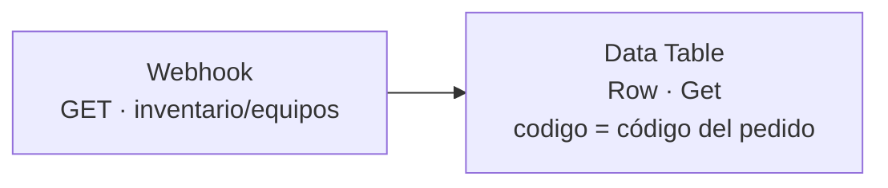

### Paso 5. Elegir qué se comparte

Conectá **Edit Fields (Set)** después de Data Table. Este nodo es **el empleado que decide qué escribir en la constancia**. En **Mode → Manual Mapping**, agregá estos tres campos de tipo String con **Expression** en sus valores:

| Campo de salida | Valor |
|---|---|
| `codigo` | `{{ $json.codigo }}` |
| `ubicacion` | `{{ $json.ubicacion }}` |
| `estado` | `{{ $json.estado }}` |

En **Include in Output**, elegí **No Input Fields** o activá **Keep Only Set Fields**, según el texto que muestre el nodo. De esa manera, la salida contiene solo los tres campos elegidos. Verificá que no incluya `nota_interna` ni campos agregados por n8n.

**Predicción:** si en la tabla hay cuatro columnas y acá solo escribimos tres, ¿qué va a recibir quien consulta?

> **Acá establecemos el límite de información.** La tabla guarda cuatro datos por ficha, pero la API entrega solo tres. El límite existe **porque vos configuraste el nodo de salida**, no porque todas las APIs lo hagan automáticamente.

**Tu canvas al terminar el paso 5:**

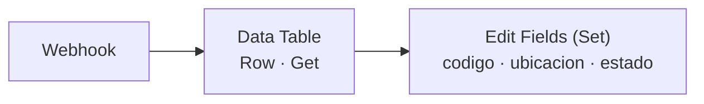

### Paso 6. Responder y publicar

1. Conectá **Respond to Webhook** después de Edit Fields.
2. En **Respond With**, elegí **First Incoming Item**: devuelve el JSON que llega desde Edit Fields.
3. Guardá y **publicá / activá** el workflow (**Publish** / **Activate**, según lo que muestre la interfaz). Esto habilita la dirección en el n8n local; **no** es una publicación en internet.
4. Abrí el Webhook, copiá su **Production URL** y anotala en tus apuntes. Para esta práctica termina en `/webhook/inventario/equipos`.

**Tu canvas al terminar el paso 6 — el workflow Inventario completo.** Son dos tramos en una sola fila: el de preparación (que se ejecuta una vez) y el de la ventanilla (que atiende cada pedido). Entre ellos no hay línea porque no están conectados:

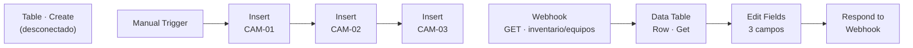

✅ **Checkpoint:** Inventario aparece publicado/activado y tenés anotada la Production URL completa. En tu canvas los dos tramos se ven separados: preparación a un lado, ventanilla al otro.

**Para observar:** ¿en qué nodo se decide **qué fila** buscar? ¿En qué nodo se decide **qué campos** recibe el otro sistema? Son dos decisiones distintas, en dos lugares distintos.

## 4. Sistema Seguimiento: hacer el pedido

Antes de construir el segundo workflow, una prueba que sorprende: **vos ya sabés consultar una API**.

### Paso 7. Consultar desde el navegador

Abrí una pestaña nueva y escribí en la barra de direcciones la Production URL con el parámetro:

```text
http://127.0.0.1:5678/webhook/inventario/equipos?codigo=CAM-02
```

**Predicción antes de apretar Enter:** ¿va a aparecer una página con formato? ¿Qué campos van a verse?

Lo que aparece es la **respuesta JSON de la API**, escrita en la barra igual que una página web. Acá no hay workflow de Seguimiento todavía: el navegador hizo de cliente. Esto es exactamente lo que hacen las páginas que consultan datos todo el día.

Ahora probá los otros dos códigos, cambiando el valor en la barra:

| Pedido | Qué esperás ver |
|---|---|
| `?codigo=CAM-01` | `Recepción`, `operativa` |
| `?codigo=CAM-03` | `Salón de juegos`, `operativa` |
| `?codigo=CAM-99` | ¿? |

El último caso es el interesante: anotá qué aparece cuando el dato no existe. Lo retomamos en la sección 5.

### Paso 8. El workflow que consulta solo

Ahora sí: creá un segundo workflow llamado **Seguimiento - consultar inventario**, para que el pedido lo haga un sistema y no una persona. Conectá estos dos nodos:

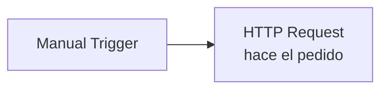

1. En **HTTP Request**, elegí **Method → GET**.
2. Pegá la Production URL del Webhook. Como los dos workflows corren en el mismo contenedor, podés usar:

```text
http://127.0.0.1:5678/webhook/inventario/equipos
```

3. Activá **Send Query Parameters**. Agregá **Name → codigo** y **Value → CAM-02**.
   (Así se arma el mismo `?codigo=CAM-02` que escribimos a mano en el navegador: n8n lo arma por nosotros.)
4. **Predicción y ejecución.** Abrí el **OUTPUT** de HTTP Request. La respuesta esperada es:

```json
{
  "codigo": "CAM-02",
  "ubicacion": "Pasillo",
  "estado": "sin señal"
}
```

**Así tiene que quedar tu canvas al terminar el paso 8 — el workflow Seguimiento completo:**

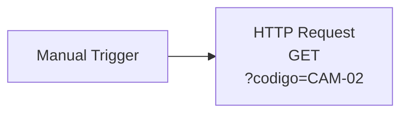

✅ **Checkpoint:** el OUTPUT muestra JSON con exactamente **tres campos**. Compará con la tabla: `nota_interna` está guardada en Inventario, pero **no viajó** en la respuesta.

### Paso 9. Una prueba para comprobar el límite

En HTTP Request, conservá `codigo=CAM-02` y agregá otro parámetro: **Name → columna**, **Value → nota_interna**. Ejecutá otra vez.

**Predicción:** ¿ahora se fuga la nota? La respuesta debe seguir mostrando **únicamente los tres campos** que definiste en Edit Fields: el workflow Inventario no lee ese parámetro, y no puede cambiarse lo que comparte desde el lado del que consulta.

Este límite describe **qué información devuelve esta API**. No limita automáticamente cuántas consultas se pueden hacer: son reglas distintas.

**Para reflexionar:** ¿qué eligió el sistema que consultó (el código)? ¿Qué eligió el sistema que respondió (los campos)? ¿Quién debería autorizar que se comparta la nota en un sistema real?

## 5. Si algo no sale: síntoma → qué mirar

En soporte técnico se diagnostica por partes. Esta tabla va en el orden en que algo puede fallar, desde el final del recorrido hacia atrás:

| Síntoma que ves | Qué mirar primero | Cómo comprobarlo |
|---|---|---|
| El navegador no abre n8n | Docker Desktop y el entorno de la clase 6 | Iniciá como en la [clase 6](../clase_06/n8n/README.md) y abrí `http://127.0.0.1:5678`. |
| `404` o "not found" en la consulta | Inventario está publicado y usás la **Production URL** (`/webhook/`, no `/webhook-test/`) | Mirá el switch del workflow y el prefijo de la dirección. |
| El pedido llega pero no devuelve datos | El `codigo` del parámetro existe en la tabla | Abrí **Data tables → equipos_clase9** y compará el valor letra por letra. |
| La consulta no llega al nodo de búsqueda | El Webhook está conectado al nodo Data Table | Revisá la línea de conexión en el canvas. |
| La respuesta trae de más (aparece `nota_interna`) | Edit Fields está **antes** de Respond to Webhook y **No Input Fields** está activo | Mirá el orden de los nodos y esa opción. |
| La tabla tiene filas repetidas | Ejecutaste el nodo de carga más de una vez | No afecta la práctica; la API devuelve la primera coincidencia. |

### El caso del código que no existe

Cuando probaste `CAM-99` en el navegador, probablemente viste una respuesta vacía o un error. Eso es **información útil**, y hay que leerla sin apurarse:

- **Hecho observado:** la API no devolvió datos para `CAM-99`.
- **Lo que NO sabemos:** si el equipo existe y está mal registrado, o si el código está mal escrito.
- **Hipótesis posibles:** error de tipeo, equipo dado de baja, tabla incompleta.
- **Verificación pendiente:** revisar el padrón real del inventario.
- **Decisión:** en una API completa habría que definir una respuesta explícita para "no encontrado" (por ejemplo, un mensaje con estado `404`). Esta versión sencilla no lo hace. Lo retomamos en la [clase 10](../clase_10/clase_10_workflows_avanzados.md).

Y sobre el caso original: el inventario dice `sin señal`. Eso es un **dato del sistema**, no un diagnóstico. **Hipótesis:** podría haber un problema de alimentación, conexión o equipo. **Pendiente:** comprobarlo con el procedimiento autorizado.

### Cuidado profesional

En clase usamos solo información ficticia. Conectar sistemas reales, abrir accesos o compartir información requiere autorización; si una acción excede tu alcance, **escalala**. Esta API local no tiene autenticación y no está preparada para datos reales.

## 6. Puesta en común y cierre

En el TV, algunos comparten lo que observaron. Entre todos respondan:

1. ¿Qué información envió Seguimiento para hacer la consulta?
2. ¿Qué información recibió y qué dato de la tabla quedó afuera?
3. ¿En qué nodo se definió ese límite?
4. ¿Qué pasó cuando el código `CAM-99` no existía, y qué falta verificar antes de actuar sobre la cámara?

### Actividad rápida con IA (5 minutos, si alcanza el tiempo)

Pedile a la IA que invente un equipo ficticio nuevo en el mismo formato JSON —por ejemplo, una impresora o un lector de tarjetas— y cargalo en la tabla con un nodo de inserción. Después consultá ese código desde Seguimiento y comprobá que aparezca en la respuesta.

**Regla:** con la IA compartí solo ejemplos ficticios, nunca datos reales. Y la respuesta de la IA **siempre** comparala con lo que muestra n8n: si no coinciden, manda lo observado en la ejecución.

**Próxima clase:** [workflows avanzados](../clase_10/clase_10_workflows_avanzados.md), donde el mismo recorrido se hace con varios pedidos y con manejo de errores.

## Materiales y referencias

- [Registro ficticio del inventario](datos_inventario.json).
- [Entorno de n8n de clase 6](../clase_06/n8n/README.md).
- Documentación de n8n: [Data Table](https://docs.n8n.io/integrations/builtin/core-nodes/n8n-nodes-base.datatable/), [Webhook](https://docs.n8n.io/integrations/builtin/core-nodes/n8n-nodes-base.webhook/) y [HTTP Request](https://docs.n8n.io/integrations/builtin/core-nodes/n8n-nodes-base.httprequest/).
