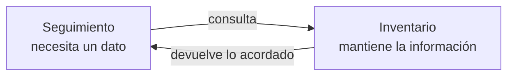
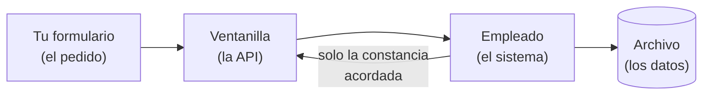
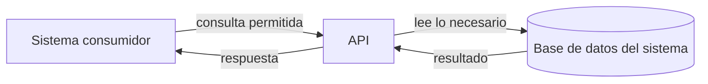
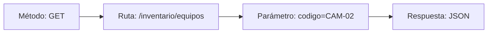
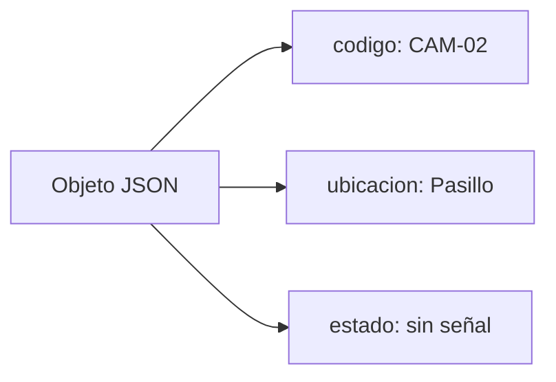
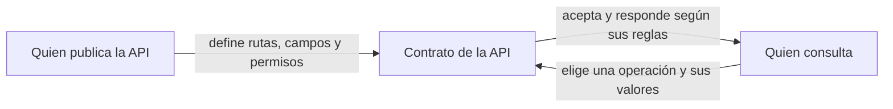
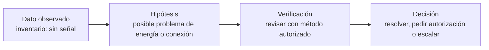
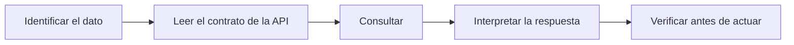

# Antes de consultar un sistema: integración y API

Este material introduce las ideas que usamos en la clase 9: cómo se comunican dos sistemas, qué papel cumple una API y quién decide qué información se comparte. Es una lectura previa a la práctica guiada en la [guía de clase](clase_9_integracion_con_sistemas.md).

> Si preferís leer poco antes de la clase, alcanza con la **sección 2** (la ventanilla) y la **sección 5** (dónde nacen los límites). El resto lo vamos reconstruyendo con la práctica.

### Vocabulario mínimo

| Palabra | En lenguaje común |
|---|---|
| Sistema | Cualquier programa donde se guarda o se trabaja información: inventario, seguimiento, cámaras. |
| Integración | La forma en que dos sistemas se pasan datos sin mezclarse por dentro. |
| API | La ventanilla de un sistema: el lugar por donde otros pueden pedirle información. |
| Cliente / consumidor | El sistema que hace el pedido. |
| GET | Un pedido de "consultar sin cambiar nada". |
| Parámetro | El dato que completás en el pedido para precisar qué buscás. |
| JSON | La forma de escribir la respuesta con campos de nombre y valor. |
| Contrato | El acuerdo sobre qué se puede pedir, cómo y qué se recibe. |

## 1. Dos sistemas, dos responsabilidades

Imaginá que el inventario registra el estado de las cámaras y que el sistema de seguimiento organiza las tareas del equipo. Cada sistema tiene una responsabilidad y guarda información que el otro puede necesitar.

Por ejemplo, si una cámara aparece sin señal, Seguimiento puede necesitar consultar en qué lugar está y qué estado figura en el inventario. La consulta **ayuda a preparar una verificación**. Por sí sola no demuestra por qué la cámara dejó de transmitir.



**Para pensar:** si un sistema conoce la ubicación y otro registra el estado, ¿cuál de los dos debería ser la fuente de cada dato?

La **integración** conecta sistemas para que puedan intercambiar información o coordinar una tarea. La integración puede usar un archivo, una base compartida, una API u otro mecanismo. En esta clase nos enfocamos en la API porque permite hacer una consulta justo cuando se necesita.

## 2. La API como ventanilla

Una **API** es un conjunto de reglas y direcciones que un sistema ofrece para que otros programas puedan pedirle información o solicitarle una acción. Funciona como la **ventanilla de informes** de un sector:



- Vos no entrás al archivo: completás el **formulario** que la ventanilla admite.
- El empleado busca **como quiere** y te alcanza **solo lo que está permitido mostrar**.
- Vos no necesitás saber cómo están ordenadas las fichas para recibir la constancia.

Una API **no** significa que un sistema tenga acceso libre a todo lo que guarda el otro. El dueño del sistema publica solo algunas operaciones y algunos datos.

### API y base de datos cumplen funciones diferentes

Una **base de datos** organiza y guarda información (el archivo). Una **API** define cómo otro sistema puede pedir parte de esa información (la ventanilla). La API es una capa de comunicación; la base es uno de los lugares donde el sistema conserva datos.



Por eso, dar acceso directo a la base **no** es lo mismo que ofrecer una API. Con acceso directo, el otro sistema tendría que conocer tablas y permisos. Con una API, el sistema que posee los datos conserva el control de las consultas que expone.

**Lectura del ejemplo:** Seguimiento pregunta por un equipo. Inventario decide cómo encontrarlo y qué campos devolver. Seguimiento recibe el resultado sin consultar directamente las tablas internas de Inventario.

## 3. Una solicitud tiene partes

Para que dos programas se entiendan, acuerdan qué pedido enviar y cómo interpretar la respuesta. Es el **formulario de la ventanilla**: tiene campos fijos. Una consulta web sencilla suele incluir:

| Parte | Pregunta que responde | Ejemplo |
|---|---|---|
| Método | ¿Qué acción quiero hacer? | `GET`: quiero consultar. |
| Ruta | ¿Qué recurso quiero consultar? | `/inventario/equipos` |
| Parámetro | ¿Qué registro busco? | `codigo=CAM-02` |
| Respuesta | ¿Qué información recibí? | Un JSON con código, ubicación y estado. |



Todo junto se escribe como una dirección de página web:

```text
/inventario/equipos?codigo=CAM-02
```

`/inventario/equipos` es la ruta (a qué ventanilla vas) y `codigo=CAM-02` es el parámetro (qué registro buscás). El `?` separa uno de otro. El consumidor puede **cambiar el código** para consultar otro registro permitido, pero eso **no** le habilita a inventar una operación nueva.

`GET` expresa que se solicita una lectura. Otros métodos HTTP expresan otras acciones, como enviar o modificar información. El significado concreto depende del contrato de la API: método, dirección, datos admitidos y respuesta esperada.

## 4. JSON: una forma de empaquetar datos

JSON es un formato de texto para representar datos estructurados. Usa nombres de campos y sus valores. En esta consulta, la respuesta puede verse así:

```json
{
  "codigo": "CAM-02",
  "ubicacion": "Pasillo",
  "estado": "sin señal"
}
```

Podés leerlo como pares de nombre y valor: el campo `ubicacion` contiene `Pasillo`; el campo `estado` contiene `sin señal`. El acuerdo sobre los nombres importa: si un sistema devuelve `ubicacion` y el otro espera `lugar`, hace falta traducir o acordar el formato.



El JSON no explica por sí mismo qué significa un dato ni si es correcto. Para eso hay que conocer el contexto y el acuerdo entre los sistemas.

## 5. ¿Dónde nacen los límites?

Quien construye la API define las reglas de lo que ofrece. Puede decidir:

- qué rutas existen;
- qué método se acepta en cada ruta;
- qué parámetros se reciben;
- qué datos salen en la respuesta;
- qué operaciones pueden consultar o cambiar información;
- quién puede realizar cada operación.

El sistema que consulta elige entre las opciones que la API ya ofrece. No debería poder cambiar el SQL interno ni pedir campos que la API no expone simplemente agregando parámetros.



Los límites no aparecen automáticamente por usar una API. Alguien debe definirlos e implementarlos. Una regla que no está configurada o comprobada no se puede dar por existente.

**Distinción importante:** decidir qué campos devuelve una consulta es un límite del contenido. Limitar cuántas consultas se aceptan por minuto es un límite de frecuencia. Son reglas diferentes y requieren configuraciones diferentes.

### La respuesta también trae un "código de atención"

Además del contenido, una respuesta incluye un **estado HTTP**: un número que dice cómo se atendió el pedido. Por ejemplo, `200` suele indicar que la solicitud se atendió bien. Ojo: ese número **no** afirma que el dato sea verdadero, que el problema físico esté resuelto ni que tu hipótesis sea correcta. Solo dice que la ventanilla respondió. Hay que leer el contenido y entender qué sistema lo produjo.

## 6. Leer el dato sin saltar a una conclusión

En soporte técnico conviene separar lo que el sistema muestra de lo que creemos que sucede:



- **Hecho observado:** el inventario registra que la cámara está sin señal.
- **Hipótesis:** puede haber una falla de alimentación, conexión u otro componente.
- **Verificación pendiente:** comprobar la condición de red y del equipo con los procedimientos permitidos.
- **Decisión:** resolver si está dentro del alcance autorizado, pedir autorización o escalar.

Una consulta puede orientar el próximo paso, pero no reemplaza una inspección ni una confirmación. La información también puede estar desactualizada o incompleta.

## 7. Acceso y cuidado profesional

Una API puede estar en una red local y aun así necesitar controles de acceso. La dirección local indica dónde se encuentra el servicio; no demuestra quién está autorizado a consultarlo.

En un ejemplo de aprendizaje se usan datos inventados y una API de alcance local. En un sistema real, hay que acordar quién puede consultar qué datos, proteger credenciales, validar cambios y pedir autorización antes de abrir accesos o conectar servicios. Si el pedido puede exponer datos sensibles o afectar una operación, se detiene la acción y se consulta el procedimiento correspondiente.

## Para recordar

Cuando un sistema consulta a otro, preguntate:

1. ¿Quién es dueño del dato y cuál sistema lo mantiene?
2. ¿Qué API ofrece el sistema y qué operación está permitida?
3. ¿Qué método, ruta y parámetros forman la solicitud?
4. ¿Qué campos contiene la respuesta y qué significa cada uno?
5. ¿Qué es un hecho observado, qué es una hipótesis y qué falta verificar?
6. ¿Hay autorización para acceder, compartir o cambiar esa información?



## Relación con la clase 9

La [guía de la clase 9](clase_9_integracion_con_sistemas.md) presenta este recorrido con dos sistemas ficticios. Este documento aporta las ideas; la guía describe la práctica con n8n.

## Referencias para ampliar

- [Clase 5: cómo hablan los sistemas](../clase_05/clase_5_como_hablan_los_sistemas.md).
- [Webhook en n8n](https://docs.n8n.io/integrations/builtin/core-nodes/n8n-nodes-base.webhook/).
- [HTTP Request en n8n](https://docs.n8n.io/integrations/builtin/core-nodes/n8n-nodes-base.httprequest/).
