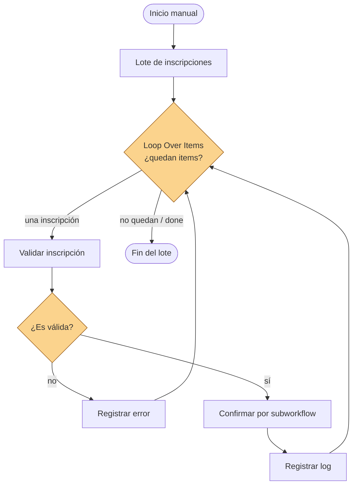
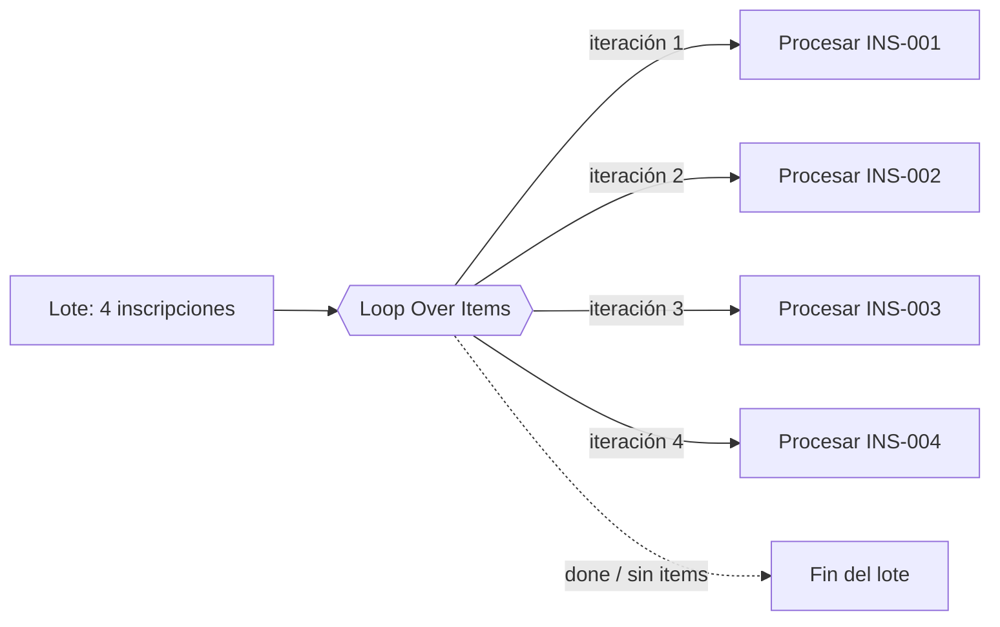
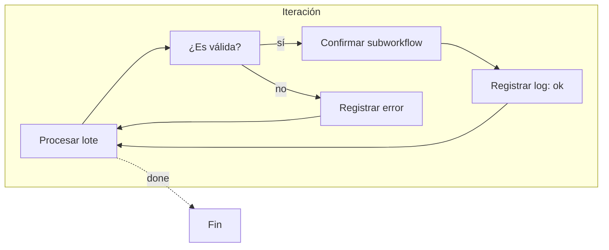

# Clase 10 — Workflows Avanzados

**Duración:** 120 minutos  
**Nivel:** inicial, retoma los flujos de las clases 6 y 7 (nodos, IF, ramas)  
**Modalidad:** repaso breve, explicación con diagramas, construcción guiada y práctica en equipos  
**Producto:** un workflow que procesa un **lote de inscripciones** una por una (loop), tolera fallas con errores y reintentos, registra logs y reutiliza la confirmación de la clase 7 como subworkflow

## Idea central

En las clases anteriores el flujo siempre procesaba **una sola inscripción**. En la vida real, sin embargo, las inscripciones no llegan de a una: llegan **en lote**, y algunas pueden llegar incompletas o fallar durante el procesamiento.

Esta clase agrega tres capacidades que convierten un flujo simple en un flujo **avanzado**:

1. **Repetir:** procesar cada inscripción del lote una por una (loops e iteraciones).
2. **Tolerar fallas:** si una inscripción falla, el flujo no se detiene: lo registra, lo reintenta o lo deriva a un camino de error (manejo de errores y reintentos).
3. **Reutilizar y registrar:** separar la confirmación en un subworkflow reutilizable y dejar rastro de lo que ocurre en cada ejecución (logs y monitoreo).

```text
Inicio manual
  → Lote de inscripciones
  → Loop Over Items (una por una)
  → Validar inscripción
  → ¿Es válida?
     ├─ no → Registrar error y continuar
     └─ sí → Confirmar (subworkflow de la clase 7)
             → Registrar log
             → ¿Quedan items?
                ├─ sí → repetir
                └─ no → Fin del lote
```



> Un **loop** (bucle) es una estructura que repite un bloque de pasos mientras queden datos por procesar. Cada repetición se llama **iteración**.

## Objetivos de aprendizaje

Al finalizar la clase, cada estudiante podrá:

- explicar para qué sirve repetir pasos dentro de un flujo y cuándo conviene hacerlo;
- usar el nodo **Loop Over Items** para procesar un lote de items uno por uno;
- reconocer las salidas `loop` y `done` de un loop;
- explicar la diferencia entre un error que detiene el flujo y uno que se registra y continúa;
- configurar el modo **continue on fail** (continuar ante error) en un nodo;
- construir un nodo **Error Trigger** para recibir los errores del flujo;
- registrar eventos (éxito, error, reintento) en un log simple con fecha y estado;
- extraer la confirmación de la clase 7 a un **subworkflow** reutilizable con **Execute Workflow**;
- reconocer buenas prácticas de diseño: nombres claros, contrato de datos y tratamiento de excepciones;

## Preparación

Esta clase presupone que n8n está instalado y funcionando con Docker (clase 6). Antes del encuentro:

1. Comprobá que Docker Desktop está iniciado.
2. Iniciá n8n desde la carpeta `n8n/` de la clase 6:

```console
docker compose up -d
```

3. Abrí `http://127.0.0.1:5678` y verificá que la cuenta y los workflows de las clases 6 y 7 siguen disponibles.

Si el entorno no quedó funcionando en la clase anterior, seguí la sección **Preparación del entorno n8n** de la [clase 6](../clase_06/clase_6_primeros_pasos_con_n8n.md).

---

## 1. Retomar el workflow (10 min)

1. Abrí n8n en `http://127.0.0.1:5678`.
2. Abrí el workflow **Clase 7 - Registro de inscripciones con IF**.
3. Ejecutalo y verificá que los nodos siguen funcionando: **Preparar confirmación**, **¿Modalidad presencial?**, **Confirmación presencial** y **Confirmación remota**.

Guardá una copia del workflow con otro nombre (**Clase 10 - Inscripciones con loop y errores**) antes de modificarlo. Así mantenés intacto el material de la clase 7.

> En esta clase el workflow va a **crecer**: primero agregamos un lote de entrada, luego un loop y después el manejo de errores. Trabajá por etapas y probá cada una antes de seguir.

---

## 2. ¿Qué problema resuelve un loop? (10 min)

Mirá la atención de un incidente en el casino: a veces llega un solo aviso, pero muchas veces llegan **varios juntos** (tres cámaras caídas, cinco tickets de impresoras, un grupo de inscripciones). Hacer lo mismo para cada caso "a mano" es repetitivo y propenso a olvidos.

Lo mismo le pasa a un flujo: hasta ahora procesaba un item y terminaba. Un **loop** le permite decir:

> "Mientras queden items por procesar, tomá el siguiente, procesalo y volvé."



El nodo **Loop Over Items** recibe el lote completo y **entrega de a un item por vez** por la salida `loop`. Cuando ya no quedan items, entrega el resultado por la salida **`done`**.

Respondé en voz alta:

- ¿Qué tareas de tu trabajo se repiten igual para varios casos seguidos?
- ¿Qué pasaría en un flujo si intentamos procesar cuatro inscripciones y una falla? ¿Se detendría todo?

---

## 3. Construcción guiada: lote + loop (30 min)

### Paso 1 — Cargar el lote de inscripciones

Vas a reemplazar la inscripción única por un **lote** de varias. Usá el archivo documental `n8n/Clase 10 - Lote y contrato de inscripciones.json` (de la carpeta de esta clase) como referencia para copiar los datos.

1. En el nodo **Cargar inscripción** (Edit Fields), dejá los campos pero cambiá el valor de `inscripcion_id` a `INS-001`, `nombre` a `Lucía Gómez`, `modalidad` a `presencial`, etc.

> Un lote real llega como una **lista de items**. En n8n, cuando un nodo emite varios items, cada uno se procesa por separado. Ahora el nodo **Cargar inscripción** va a emitir **cuatro items** (INS-001 a INS-004): eso es el lote.

Podés probar de dos maneras:

- **Opción A (con el nodo de carga):** en **Cargar inscripción** agregá los cuatro items con el botón **Add item** (Edit Fields permite múltiples items con el mismo esquema de campos).
- **Opción B (con un nodo Code):** agregá un nodo **Code** conectado al inicio, con este código que emite cuatro items:

```javascript
// Lote de inscripciones de ejemplo (una con datos incompletos)
return [
  { json: { inscripcion_id: "INS-001", nombre: "Lucía Gómez", email: "lucia@example.com", taller: "Introducción a n8n", modalidad: "presencial", cantidad_asistentes: 1, confirmada: true } },
  { json: { inscripcion_id: "INS-002", nombre: "Martín Rojas", email: "martin@example.com", taller: "Automatizaciones para equipos", modalidad: "virtual", cantidad_asistentes: 2, confirmada: false } },
  { json: { inscripcion_id: "INS-003", nombre: "Ana Pérez", email: "", taller: "IA para soporte", modalidad: "presencial", cantidad_asistentes: 1, confirmada: false } },
  { json: { inscripcion_id: "INS-004", nombre: "Jorge Díaz", email: "jorge@example.com", taller: "Redes para soporte", modalidad: "virtual", cantidad_asistentes: 0, confirmada: false } }
];
```

> En el lote hay un caso "trampa": **INS-003 tiene `email` vacío** y **INS-004 tiene `cantidad_asistentes` en 0**. Servirán para probar validaciones y errores más adelante.

### Paso 2 — Agregar el loop

1. Agregá un nodo **Loop Over Items** (también llamado *Split In Batches*).
2. Conectalo desde **Cargar inscripción**.
3. Renombralo **Procesar lote**.
4. En **Batch Size** poné `1` (un item por vez).

El nodo queda así:

```text
Cargar inscripción (4 items)
  → Procesar lote (Loop Over Items, batch = 1)
      ├─ salida loop → cada inscripción de a una
      └─ salida done → cuando no quedan más
```

### Paso 3 — Conectar la validación al loop

1. Agregá un nodo **IF** y conectalo desde la salida **loop** de **Procesar lote**.
2. Renombralo **¿Es válida?** y configurá la condición para que considere válida una inscripción con:

```text
{{ $json.email }}   not equal   ""
```

(En *Value 1* `{{ $json.email }}`, en *Operation* `String → not equal`, en *Value 2* una cadena vacía).

> Además del email, una inscripción válida debería tener `nombre` y `cantidad_asistentes` mayor a cero. Lo dejamos con una sola condición por simplicidad; validar más condiciones es exactamente el ejercicio de la sección 5.

### Paso 4 — Ejecutar y observar el loop

Ejecutá el workflow y abrí **Procesar lote**:

- ¿Cuántos items entraron?
- ¿Cuántas iteraciones se ejecutaron?
- ¿Qué contiene la salida `done` al final?
- ¿Cuántos pasaron por la rama `true` y cuántos por `false` del IF?

> **Concepto clave:** el loop una por una cambia cómo leemos los nodos: ahora un nodo puede ejecutarse **varias veces en la misma ejecución**, una por cada iteración.

---

## 4. Manejo de errores y reintentos (20 min)

### 4.1 El problema

El lote trae un caso inválido (INS-003, sin email). Hoy, si dejamos que ese item llegue a la confirmación y falle, **el flujo se detiene completo** y las demás inscripciones no se procesan.

La meta: que una falla **no detenga el lote**. Hay dos mecanismos:

- **Continue on fail (continuar ante error):** configurado en un nodo, hace que si ese nodo falla, el item siga por una rama especial de error en lugar de detener todo.
- **Nodo Error Trigger:** se conecta a esa rama de error y recibe **todos los errores** del flujo.

```text
Proceso normal:
  Lote → Validar → Confirmar → Log → done

Con error (continue on fail):
  Lote → Validar → Confirmar → ⚠ error → Error Trigger → Registrar error → done
```

### 4.2 Configurar continue on fail y Error Trigger

1. Abrí el nodo **Confirmación presencial** (o el que corresponda al final del flujo).
2. En **Settings** (pestaña de configuración del nodo) activá **Continue On Fail**.
3. Agregá un nodo **Error Trigger** (buscalo como **Error (workflow)** / *n8n-nodes-base.errorTrigger*).
4. Conectalo después del nodo que falla: cuando hay un error con continue on fail, el item viaja por el **Error Trigger**.
5. En la salida del Error Trigger, agregá un nodo **Edit Fields** llamado **Registrar error** que guarde:

| Campo | Tipo | Valor (Expression) |
|---|---|---|
| `tipo_evento` | String | `error` |
| `inscripcion_id` | String | `{{ $json.inscripcion_id }}` |
| `detalle` | String | `{{ $json.error || $json.message }}` |
| `fecha` | String | `{{ $now.toISOString() }}` |

> El **Error Trigger** no se dispara solo: solo funciona cuando está conectado a la rama de error de un nodo con **Continue On Fail**. Si el flujo no tiene errores, ese camino nunca se ejecuta.

### 4.3 Reintentos

En n8n, cada nodo tiene un ajuste de **reintentos** (Settings → Retry on fail). Un reintento vuelve a ejecutar el mismo nodo un número de veces antes de considerarlo fallido.

- **Reintento 0 (por defecto):** si falla, falla.
- **Reintento 1 o más:** si falla, espera unos segundos y vuelve a intentar.

Pensá en el caso de un servicio temporalmente caído (por ejemplo, una API de envío de mails): un reintento puede resolverlo sin intervención humana.

1. Abrí un nodo que podría fallar (por ejemplo, **Confirmación presencial**).
2. En **Settings → Retry On Fail**, activá el reintento y probá con **1 reintento**.

Respondé:

- ¿Cuándo conviene reintentar? ¿Y cuándo **no** conviene reintentar (por ejemplo, un dato inválido)?
- ¿Qué diferencia hay entre *reintentar* y *registrar el error y seguir*?

---

## 5. Logs y monitoreo (15 min)

Un log es un **registro de eventos** que deja rastro de lo que hizo el flujo. Sirve para responder después: ¿qué se procesó? ¿qué falló? ¿cuándo?

Los logs no remplazan a la pestaña **Executions** de n8n (que ya guarda cada ejecución), pero permiten **guardar el resultado del propio flujo** y verlo en cualquiera de sus salidas.

Construcción:

1. Agregá un nodo **Edit Fields** llamado **Registrar log** conectado a la rama `true` del IF (después de la confirmación).
2. Agregá los campos:

| Campo | Tipo | Valor (Expression) |
|---|---|---|
| `tipo_evento` | String | `ok` |
| `inscripcion_id` | String | `{{ $json.inscripcion_id }}` |
| `modalidad` | String | `{{ $json.modalidad }}` |
| `fecha` | String | `{{ $now.toISOString() }}` |

3. Conectá **Registrar log** de vuelta al nodo **Procesar lote**: así el loop vuelve a consultar si quedan items (esto cierra la iteración).

> **Monitorear** es mirar esos logs con propósito: revisar las ejecuciones en la pestaña *Executions*, ver cuántos items pasaron por cada rama, y detectar errores recurrentes antes de que lleguen al usuario.



---

## 6. Modularización: la confirmación como subworkflow (20 min)

El flujo ya procesa un lote con errores y logs. Pero el bloque de confirmación (¿Modalidad presencial? → Confirmación presencial/remota) quedó **dentro** del workflow grande. Cada vez que querramos reutilizarlo en otro flujo, habría que copiarlo.

La solución es la **modularización**: extraer ese bloque a un **subworkflow** reutilizable.

### Paso 1 — Crear el subworkflow

1. Creá un workflow nuevo llamado **Confirmar inscripción (subworkflow)**.
2. Agregá el nodo **Execute Workflow Trigger** (o *When Executed by Another Workflow*). Este nodo recibe los datos del workflow que lo llama.
3. Copiá los nodos **¿Modalidad presencial?**, **Confirmación presencial** y **Confirmación remota** desde el workflow de la clase 7 y conectalos al trigger.

El subworkflow queda así:

```text
Execute Workflow Trigger
  → ¿Modalidad presencial?
     ├─ true → Confirmación presencial
     └─ false → Confirmación remota
```

4. Guardá el subworkflow.

### Paso 2 — Llamarlo desde el workflow principal

1. Volvé al workflow **Clase 10 - Inscripciones con loop y errores**.
2. Reemplazá los nodos de confirmación por un nodo **Execute Workflow** llamado **Confirmar**.
3. En el nodo **Confirmar**, seleccioná el **workflow por ID** (o *From list*) y elegí **Confirmar inscripción (subworkflow)**.
4. En el modo, elegí **Run once for each item** (ejecutar una vez por cada item que entra).

> Los datos de la inscripción que entran al **Execute Workflow** llegan al **Execute Workflow Trigger** del subworkflow, y lo que devuelve el último nodo del subworkflow vuelve al workflow principal.

### Paso 3 — Ejecutar

1. Ejecutá el workflow con el subworkflow.
2. Abrí el nodo **Confirmar**: deberías poder ver *View sub-execution* con el detalle de la ejecución del subworkflow.

Respondé:

- ¿Qué ventaja tiene tener la confirmación separada?
- Si mañana cambia el texto de la confirmación, ¿dónde hay que modificarlo? ¿Una sola vez?

---

## 7. Ejercicio en equipos: robustecer su flujo (15 min)

Trabajen en dos grupos. Cada grupo toma el flujo que diseñó en la clase 7 (entrada, decisión, salida y excepción) y lo **robustece**:

1. **Lote:** la entrada pasa a ser varios items a la vez (pensá 3-4 casos reales).
2. **Loop:** indicá en qué nodo se repite el procesamiento y dónde termina (`done`).
3. **Error:** definí qué pasa si un item es inválido: ¿se reintenta, se registra y sigue, o se escala?
4. **Log:** definí qué campos registra cada evento y cómo se distingue un `ok` de un `error`.
5. **Subworkflow:** elegí el bloque que separarías para reutilizar en otros flujos.

**Entregable del grupo:** un diagrama (ASCII o Mermaid) del flujo robustecido con las cinco partes marcadas, y una frase que explique dónde y por qué se aplica la **excepción**.

- **Grupo 1:** atención de tickets o incidentes (clasificar, derivar y escalar).
- **Grupo 2:** mantenimiento o verificación de equipos (verificar, intervenir y registrar).

---

## 8. Puesta en común (10 min)

Cada grupo presenta su flujo (5 min): qué procesa en loop, qué pasa si falla, qué registra en el log y qué extraería como subworkflow.

El otro grupo hace una observación de acierto y una de mejora. El docente cierra con la síntesis común: los patrones que se repiten (loop + validación + error + log) son la **estructura típica de un flujo robusto**.

---

## 9. Cierre (5 min)

Completá oralmente:

1. Un loop entrega los items de a uno por la salida ______ y los combinados por la salida ______.
2. Para que un error no detenga el flujo, el nodo debe tener activado ______.
3. El nodo ______ recibe los errores del flujo.
4. Extraer la confirmación a un subworkflow sirve para ______.
5. La excepción de un flujo es ______.

Idea final:

> Un flujo avanzado no es más complicado: es un flujo que repite, tolera fallas, deja rastro y reutiliza piezas. El contrato de entrada, la decisión y la excepción siguen siendo la base —igual que en la clase 7— pero ahora aplicados a un lote real.

## Conexión con la próxima clase

En la clase 9 vas a conectar estos flujos con aplicaciones y sistemas internos del área: archivos, carpetas compartidas, bases de datos y APIs internas. El loop, los errores y los logs que construiste hoy son exactamente las piezas que hacen segura una integración real: si un sistema está caído, el flujo reintenta o registra, y no detiene el resto.

## Materiales

Dentro de la carpeta `n8n/` de esta clase:

- [`Clase 10 - Lote y contrato de inscripciones.json`](n8n/Clase%2010%20-%20Lote%20y%20contrato%20de%20inscripciones.json): archivo documental de referencia para leer y copiar el lote de datos.
- [`Clase 10 - Inscripciones con loop y errores.json`](n8n/Clase%2010%20-%20Inscripciones%20con%20loop%20y%20errores.json): respaldo importable del workflow principal (con el loop, sin subworkflow configurado vía ID).
- [`Clase 10 - Subworkflow de confirmación.json`](n8n/Clase%2010%20-%20Subworkflow%20de%20confirmación.json): respaldo importable del subworkflow de confirmación.

> Los archivos JSON son **respaldo de referencia**: en clase se construye el workflow manualmente desde el canvas, como en las clases anteriores. El subworkflow se llama por ID desde el workflow principal, así que conviene importar primero el subworkflow y después el workflow.

## Referencias

- [Nodo Loop Over Items (Split in Batches)](https://docs.n8n.io/integrations/builtin/core-nodes/n8n-nodes-base.splitinbatches/)
- [Loops y bucles en n8n](https://docs.n8n.io/build/flow-logic/loop/)
- [Manejo de errores en n8n](https://docs.n8n.io/flow-logic/error-handling/)
- [Nodo Error Trigger](https://docs.n8n.io/integrations/builtin/core-nodes/n8n-nodes-base.errortrigger/)
- [Nodo Execute Workflow (subworkflow)](https://docs.n8n.io/integrations/builtin/core-nodes/n8n-nodes-base.executeworkflow/)
- [Reintentos en n8n (retry on fail)](https://docs.n8n.io/courses/level-two/chapter-4/)
